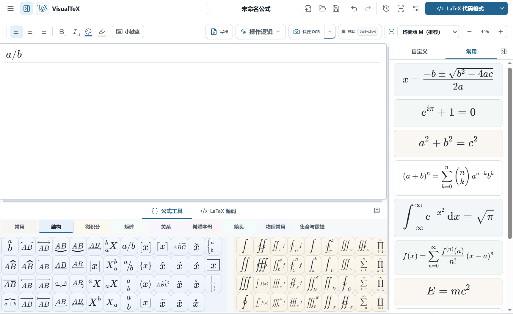

<div align="center">
  
  <h1>VisualTeX</h1>
  <p><strong>面向科研写作的跨平台公式编辑器</strong></p>
  <p>可视化公式编辑 · LaTeX 源码编辑 · 文档模式 · 公式输入法 · Word / PowerPoint / WPS 加载项 · MathType OLE · 公式 OCR</p>
  <p>
    <a href="#中文">中文</a> · <a href="#english">English</a> ·
    <a href="https://visualtex.pauljianliao.com/">官方网站</a> ·
    <a href="https://github.com/paulhe666/visualtex/releases">下载安装</a> ·
    <a href="apps/macos/docs/help/VisualTeX_帮助手册.md">帮助手册</a>
  </p>
  <p>
    <a href="https://github.com/paulhe666/visualtex/stargazers"></a>
    <a href="https://github.com/paulhe666/visualtex/releases/latest"></a>
    <a href="https://github.com/paulhe666/visualtex/releases"></a>
    <a href="https://visualtex.pauljianliao.com/"></a>
  </p>
  <p>
    
    
    
    
    
  </p>
</div>

---

# 中文

## 产品概述

VisualTeX 是适用于 macOS 和 Windows 的桌面公式编辑器，提供可视化公式输入、LaTeX 源码编辑、公式 OCR、带公式的 Markdown 文档模式、在任意应用中输入公式的公式输入法，以及 Microsoft Word、PowerPoint 和 WPS Office 加载项。公式可插入 Office 和 WPS 文档并保留后续编辑、格式转换、编号和引用所需的元数据。

<div align="center">
  
</div>

## 支持 VisualTeX 

VisualTeX 的持续开发由用户支持。如果认为该产品帮助到了您，在有经济支配能力的情况下欢迎打赏支持一下作者。是否打赏完全不会影响软件功能使用。使用问题、功能建议和 Office 加载项相关交流可加入 QQ 群：`1045801770`。

<table align="center">
  <tr>
    <td align="center"></td>
    <td align="center"></td>
    <td align="center"></td>
  </tr>
</table>

## 公式编辑器

可视化编辑区与 LaTeX 源码区实时同步。两种编辑方式可在同一份公式内容上切换。

### 可视化编辑

- 支持分式、根式、上下标、积分、求和、极限、重音、定界符、希腊字母、集合、关系、箭头和常用物理符号。
- 支持多行公式、自定义尺寸矩阵，以及 `equation`、`align`、`aligned`、`gather`、`multline`、`split`、`cases` 等环境。
- `align` 模式下，用 Shift+Enter 换行的各行默认在第一个关系符（`=`、`<`、`\le` 等）处对齐，代码中自动写入 `&`；也可手动输入 `&` 指定对齐点。
- 每一行可独立设置为行内公式或行间公式。文字与公式混排使用 `$...$`。
- Enter、Tab、结构跳出、选区包裹和命令补全针对结构化公式输入进行处理。
- 支持粗体、数学斜体和正体格式切换。
- 字体按 AxMath 的方式设置：数学字体（Computer Modern 或 newtxmath）之外，字母、希腊字母和数字可分别使用任意已安装的字体。
- AxMath 式 L 形光标；候选列表提供默认、卡片、横排和 AxMath 风格四种样式；公式工具栏的分组可自行排列、重命名和新建。
- 支持中国几何的全等号 ≌ 和相似号 ∽（exam-zh 字形与写法）。
- 支持自定义快捷键、希腊字母快捷输入、常用工具和自定义公式磁贴。
- 普通模式与小键盘模式分别保存窗口尺寸。
- 撤销、重做和历史记录保存公式内容、活动行、光标和选区状态。

### LaTeX 源码编辑

源码区基于 CodeMirror，提供以下功能：

- LaTeX 语法高亮和命令分类配色。
- 行号、当前行高亮、括号匹配和代码折叠。
- 环境层级缩进、缩进引导线、自动缩进和 Tab / Shift+Tab。
- 多行环境的结构化显示与编辑。
- 纯 LaTeX、`$...$`、`\(...\)`、`\[...\]` 等复制格式。

常用复制和导出功能不依赖 TeX Live。

## 文档模式

在主程序中编写带公式的文档，页面按 A4 排版，有分页、页码和页边距。

- 文档就是普通的 Markdown（`.md`）文件，默认保存在“文稿/VisualTeX”中，也可直接打开和编辑别处的 Markdown 文件。VisualTeX 不向文件写入专有内容，页面、字体、编号等设置另存在 VisualTeX 自己的记录里；修改只改动对应的行，并保留原来的换行符和编码。
- 编辑方式与 Obsidian 的实时预览相同：光标所在的行显示 Markdown 标记，其他行显示排版效果。
- `$$` 开始行内公式，`$$$$` 开始行间公式；公式在页面中直接编辑，候选和快捷键与公式模式相同。
- 输入 `/` 插入编号公式、公式引用、表格、脚注和参考文献；支持标题编号、摘要、图表标题、图片与图片板、任务列表、目录、代码高亮和 Mermaid 图表。
- 文档库管理文件夹和最近删除，可导出 PDF 或 Markdown。

## 公式输入法（VisualTeX Anywhere）

按全局快捷键（Windows `Ctrl+Alt+M`，macOS `Control+Option+M`；加 Shift 为行间公式）即可在任意应用的输入框中输入公式，按 Return 写入。

- 输出格式可选 LaTeX、Markdown、Unicode 或图片，并按应用分别记住。
- 公式在输入框中占据实际位置并随之换行，支持 Chrome、Edge、Electron 应用和网页中的输入框。
- 不加入系统的输入法切换列表，只在按快捷键时启用，输出后恢复原来的输入法。macOS 上无法写入的应用（备忘录、微信、QQ）在光标处显示公式条并粘贴结果。

## Microsoft Word 加载项

加载项在 Word Ribbon 中提供公式插入、编辑、转换、编号、引用、导入和批量重绘功能。

### 公式插入与编辑

- macOS 支持图片公式和 Word 原生 OMML。
- Windows 支持 VisualTeX OLE、Word OMML 和原生 MathType OLE。
- 支持行内公式和行间公式。
- 支持从 Ribbon 编辑所选公式，以及通过双击重新打开公式。
- 编辑已有公式时恢复 LaTeX、字号、显示模式和公式元数据。
- 各平台按支持范围提供图片公式、OMML、VisualTeX OLE 和 MathType OLE 之间的格式转换。

### 原生 MathType OLE（Windows）

Windows 版可将 VisualTeX 中的公式直接插入为 `Equation.DSMT4` 原生 MathType OLE 对象，覆盖以下类型：

- 行内公式。
- 无编号行间公式。
- 带 MathType 原生左编号的行间公式。
- 带 MathType 原生右编号的行间公式。

VisualTeX 对 MathType OLE 的创建、插入、渲染和编辑不依赖 MathType 安装。Windows 版当前以 MathType 7 作为稳定兼容与验收基线；使用 MathType 自带编辑器打开对象时需要安装 MathType 7。

相关转换和文档维护功能包括：

- VisualTeX OLE 与 MathType OLE 双向转换。
- Word OMML 与 MathType OLE 双向转换。
- LaTeX 重绘为 VisualTeX OLE、Word OMML 或 MathType OLE。
- VisualTeX OLE、Word OMML 和 MathType OLE 恢复为 LaTeX。
- 对选区或全文执行批量转换。
- 保留 `MTDisplayEquation`、`MTPlaceRef`、`MTEqn`、`MTChap`、`MTSec`、`ZEqnNum` 等 MathType 原生编号与引用结构。
- 同步更新文档中的 VisualTeX 编号、MathType 编号和相关引用。

原生 MathType OLE 功能由 Windows 版提供。macOS 版使用图片公式和 Word OMML。

### 公式编号与引用

- 支持连续编号、按章编号和按节编号。
- 支持点号和短横线等编号分隔符。
- 支持在文档中间插入带编号公式。
- 引用随公式编号更新。
- “更新公式编号”用于刷新编号、引用及旧版文档中的兼容结构。

### 文档导入与批量重绘

- 导入 LaTeX 或 Markdown，普通文本保留为 Word 原生段落。
- 行内公式和行间公式分别生成独立的可编辑对象。
- 扫描选区或全文中的 `$...$`、`\(...\)`、`$$...$$` 和 `\[...\]`。
- 将选区或全文中的公式原位重绘为 VisualTeX 公式或 Word OMML；Windows 版增加 MathType OLE 输出。
- 行内公式参考周围正文的字号，行间公式参考相邻段落的字号。
- 批量处理包含预检、缓存和失败回退。

## Microsoft PowerPoint 加载项

macOS 使用 PPAM 加载项，Windows 使用 VSTO 加载项。两端均支持新建公式、编辑或替换所选公式、删除公式，以及从 PowerPoint 打开 VisualTeX。

Windows 版使用 VisualTeX OLE 对象，并提供图片、OLE 和 OMML 格式转换。macOS 版使用本地矢量和图片公式。

## WPS Office 加载项

Windows 和 macOS 均支持 WPS 文字与 WPS 演示，WPS 中有按 WPS 风格排布的独立 VisualTeX 选项卡。

- WPS 文字：插入和编辑 VisualTeX 公式、MathType 公式和 WPS 公式（OMML），支持行间公式编号、交叉引用和编号格式；文档可在 Word 与 WPS 之间来回编辑。
- WPS 演示：插入和编辑 WPS 原生公式，支持字号、撤销和格式转换。
- 统一的格式转换命令：选择目标格式后，所选或全部公式不论原来是什么格式都转换过去（Word / PowerPoint 同样提供）。

## AI 助手接入（MCP）

Codex、Claude 等支持 MCP 的 AI 客户端可以通过 VisualTeX 读取和修改 Word、PowerPoint 和 WPS 中的公式：列出文档和公式、读取、插入、编号、插入引用，以及识别公式图片。默认关闭，在“设置 > AI 助手（MCP）”中开启并查看各客户端的配置方法；每次操作记入审计日志。

## 公式 OCR

OCR 支持文件选择、拖放、剪贴板粘贴和区域截图。识别结果写入当前编辑位置，多行结果按多行公式处理。

### 本地 OCR

本地 OCR 使用 PaddleOCR PP-FormulaNet，图片在本机完成处理。

- plus-S：较小模型，侧重识别速度。
- plus-M：兼顾中文、复杂公式和处理速度，作为默认模型。
- plus-L：侧重复杂公式的识别精度。

OCR 提供完整窗口、快捷 OCR 和静默 OCR 三种入口。静默 OCR 在后台完成识别并将 LaTeX 写入剪贴板。

### 在线与自建服务

支持 OpenAI 兼容接口、Ollama、Mathpix、PaddleOCR-VL 1.6 和 SimpleTex。选择在线服务后，图片发送至对应接口。API 地址、模型和密钥保存在本机配置中。

## 导出与配置

- 复制 LaTeX 或 PNG。
- 导出 Markdown、SVG 和 PNG；文档导出 PDF 或 Markdown。
- 设置透明背景或自定义 PNG 背景色。
- 保存导出目录和常用输出选项。
- 支持中英文界面、内置主题和完整配色设置。
- 保存公式字号、工具栏尺寸、面板状态和编辑模式。
- 支持配置备份与迁移。
- 自定义字符设计器支持组合矢量字形、注册 LaTeX 命令，并将自定义字符用于编辑器、命令补全、SVG、PNG 和 Office 图片公式。

## 平台说明

| 功能 | macOS | Windows |
|---|---|---|
| 桌面应用 | React、TypeScript、Tauri | React、TypeScript、Tauri |
| Word 加载项 | DOTM、VBA、AppleScriptTask、本地 Session | VSTO Ribbon、Office 事件、COM |
| PowerPoint 加载项 | PPAM、本地 Session | VSTO Ribbon、OLE |
| WPS 加载项 | WPS 文字、WPS 演示 | WPS 文字、WPS 演示（COM 加载项） |
| 公式输入法 | 不切换输入源的辅助输入法 | 在当前输入框线程中启用的 TSF 输入法 |
| 主要公式格式 | 图片公式、Word OMML | VisualTeX OLE、Word OMML、图片公式、MathType OLE |
| MathType OLE | 不提供原生创建与转换 | 创建、插入、渲染、编辑、转换、编号和引用 |
| 加载项维护 | 应用内安装、更新和修复 DOTM / PPAM | 安装器部署与 Office 位数匹配的原生组件 |

两端共用 `apps/shared` 中的编辑内核、TeX 排版和文档编辑器；Office / WPS 加载项和系统集成按平台实现。两端采用一致的公式元数据约定，用于在跨平台文档中保留 LaTeX、公式 ID 和显示模式。

## 下载与运行要求

- [VisualTeX 官方网站](https://visualtex.pauljianliao.com/)
- [GitHub Releases](https://github.com/paulhe666/visualtex/releases)
- [macOS 帮助手册](apps/macos/docs/help/VisualTeX_帮助手册.md)

macOS 版本要求 macOS 11 或更高版本。Windows 版 Office 集成稳定支持 Microsoft Office 2021 及以上桌面版的 Word / PowerPoint，以及 WPS Office。Windows 版的 MathType OLE 创建、插入、渲染和 VisualTeX 编辑功能不依赖 MathType 安装，并以 MathType 7 作为稳定兼容基线。

## 开发

macOS、Windows 两个桌面应用和网页版在同一个仓库、同一条历史中开发，共用 `apps/shared` 中的代码：

```text
visualtex/
├── apps/
│   ├── shared/      # 所有应用共用：编辑内核、TeX 排版、文档编辑器、自定义符号设计器、共用前端代码
│   ├── macos/       # macOS 应用、Tauri、DOTM/PPAM、OCR 与测试
│   ├── windows/     # Windows 应用、Tauri、VSTO/OLE、OCR 与测试
│   └── web/         # 网页版：首页、教程、浏览器中的编辑器、在线 OCR 转发
├── docs/            # 架构与设计文档、README 图片
├── tools/           # 仓库结构检查、网页版发布
└── README.md
```

常用命令：

```bash
npm run bootstrap
npm run build:macos
npm run build:windows
npm run build:web
npm run test:repository
npm run check
```

架构说明见 [docs/ARCHITECTURE.md](docs/ARCHITECTURE.md)。平台构建和测试说明见 [apps/macos/README.md](apps/macos/README.md)、[apps/windows/README.md](apps/windows/README.md) 与 [apps/web/README.md](apps/web/README.md)。

## 开源协议

Copyright (C) 2026 paulhe666

VisualTeX 使用 [GNU Affero General Public License v3.0](LICENSE)（AGPL-3.0-only）。

提交 6e4de4e 及之前的代码（包括 1.2.9 及更早的发布版）仍可按原来的 MIT License 使用；此后的所有改动（包括 1.3.0 正式版中在此之后加入的改动）只按 AGPL-3.0 提供。
代码中注明来自第三方的部分（如 CodeMirror、markdown-it 的 emoji 数据）保留其原有许可。

---

# English

## Product overview

VisualTeX is a desktop formula editor for macOS and Windows. It provides visual formula editing, LaTeX source editing, formula OCR, a document mode for Markdown documents with formulas, a formula input method for typing formulas in any app, and add-ins for Microsoft Word, PowerPoint and WPS Office. Formulas inserted into Office and WPS documents retain the metadata required for later editing, format conversion, numbering, and references.

## Formula editor

The visual editor and LaTeX source editor operate on synchronized formula content.

### Visual editing

- Fractions, roots, scripts, integrals, sums, limits, accents, delimiters, Greek letters, sets, relations, arrows, and common physics symbols.
- Multiline formulas, custom-size matrices, and environments including `equation`, `align`, `aligned`, `gather`, `multline`, `split`, and `cases`.
- In `align` mode, rows started with Shift+Enter line up at their first relation (`=`, `<`, `\le` ...) and get `&` there in the code; a typed `&` sets the point by hand.
- Independent inline or display mode for each line. Mixed text and mathematics use `$...$`.
- Formula-aware Enter, Tab, structure exit, selection wrapping, and command completion.
- Bold, math italic, and upright formatting.
- Fonts set the AxMath way: besides the math font (Computer Modern or newtxmath), letters, Greek letters and digits can each use any installed font.
- AxMath's L-shaped caret; four candidate list looks (Default, Cards, Horizontal, AxMath style); formula toolbar groups you can reorder, rename and add.
- The congruence sign ≌ and similarity sign ∽ of Chinese geometry (exam-zh's drawings and spelling).
- Custom shortcuts, quick Greek-letter input, favorite tools, and custom formula tiles.
- Separate window dimensions for standard and compact keypad modes.
- Undo, redo, and history records containing formula content, active line, cursor, and selection state.

### LaTeX source editing

The CodeMirror-based source editor provides:

- LaTeX syntax highlighting and command-group colors.
- Line numbers, active-line highlighting, bracket matching, and code folding.
- Environment-aware indentation, indentation guides, automatic indentation, and Tab / Shift+Tab.
- Structured display and editing for multiline environments.
- Copy formats for plain LaTeX, `$...$`, `\(...\)`, and `\[...\]`.

TeX Live is not required for standard copy and export operations.

## Document mode

Write documents with formulas in the main app, laid out on A4 pages with page breaks, page numbers and margins.

- A document is a plain Markdown (`.md`) file, kept in Documents/VisualTeX by default; Markdown files made elsewhere open and are edited where they are. VisualTeX writes nothing proprietary into a file: page setup, fonts, numbering and similar settings go to its own record, and an edit changes only its own lines and keeps the file's line endings and encoding.
- Editing works like Obsidian's Live Preview: the line with the caret shows its Markdown marks, the others the typeset result.
- `$$` starts an inline formula and `$$$$` a display formula; formulas are edited on the page with the candidates and shortcuts of formula mode.
- Type `/` for numbered formulas, equation references, tables, footnotes and citations; numbered headings, abstract, figure and table captions, pictures and image boards, task lists, table of contents, code highlighting and Mermaid diagrams.
- A document library with folders and Recently deleted; export to PDF or Markdown.

## Formula input method (VisualTeX Anywhere)

Press the system-wide shortcut (Windows `Ctrl+Alt+M`, macOS `Control+Option+M`; add Shift for a display formula) to type a formula in any app's text field; Return writes it.

- Output as LaTeX, Markdown, Unicode or an image, remembered per app.
- The formula takes real space in the field and wraps with it; works in Chrome, Edge, Electron apps and web text fields.
- It is not in the system's input-method switching list, is used only while the shortcut's formula is open, and gives the previous input method back afterwards. On macOS, apps it cannot write into (Notes, WeChat, QQ) get a formula strip at the caret that pastes the result.

## Microsoft Word add-in

The Word Ribbon add-in provides formula insertion, editing, conversion, numbering, references, document import, and batch redraw.

### Formula insertion and editing

- macOS supports picture formulas and native Word OMML.
- Windows supports VisualTeX OLE, Word OMML, and native MathType OLE.
- Inline and display formulas are supported.
- Formulas can be edited from the Ribbon or reopened by double-clicking.
- Reopening an existing formula restores its LaTeX, font size, display mode, and metadata.
- Format conversion is available between picture formulas, OMML, VisualTeX OLE, and MathType OLE according to platform support.

### Native MathType OLE on Windows

VisualTeX for Windows inserts formula content as native `Equation.DSMT4` MathType OLE objects in the following forms:

- Inline formulas.
- Unnumbered display formulas.
- Display formulas with native MathType numbering on the left.
- Display formulas with native MathType numbering on the right.

Creation, insertion, rendering, and editing through VisualTeX do not require a MathType installation. The Windows build uses MathType 7 as its stable compatibility and validation baseline; opening an object in the native MathType editor requires MathType 7.

Related conversion and document maintenance functions include:

- Two-way conversion between VisualTeX OLE and MathType OLE.
- Two-way conversion between Word OMML and MathType OLE.
- Redraw from LaTeX to VisualTeX OLE, Word OMML, or MathType OLE.
- Restore VisualTeX OLE, Word OMML, and MathType OLE to LaTeX.
- Batch conversion for the current selection or the full document.
- Preservation of native MathType numbering and reference structures, including `MTDisplayEquation`, `MTPlaceRef`, `MTEqn`, `MTChap`, `MTSec`, and `ZEqnNum`.
- Synchronized updates for VisualTeX equation numbers, MathType equation numbers, and their references.

Native MathType OLE support is provided by the Windows version. The macOS version uses picture formulas and Word OMML.

### Equation numbers and references

- Continuous, chapter-based, and section-based numbering.
- Dot and hyphen number separators.
- Insertion of numbered formulas in the middle of a document.
- Reference updates after equation numbers change.
- Number and reference maintenance for current and legacy document structures.

### Document import and batch redraw

- Import LaTeX or Markdown while retaining ordinary text as native Word paragraphs.
- Create separate editable objects for inline and display formulas.
- Scan the selection or full document for `$...$`, `\(...\)`, `$$...$$`, and `\[...\]`.
- Redraw formulas in place as VisualTeX objects or Word OMML, with MathType OLE output on Windows.
- Derive inline formula size from surrounding text and display formula size from adjacent paragraphs.
- Apply preflight checks, caching, and failure fallback during batch processing.

## Microsoft PowerPoint add-in

macOS uses a PPAM add-in. Windows uses a VSTO add-in. Both versions support formula creation, editing or replacement of the selected formula, formula deletion, and opening VisualTeX from PowerPoint.

The Windows version uses VisualTeX OLE objects and provides picture, OLE, and OMML conversion. The macOS version uses local vector and picture formulas.

## WPS Office add-ins

WPS Writer and WPS Presentation are supported on Windows and macOS, with a VisualTeX tab laid out in WPS's own style.

- WPS Writer: insert and edit VisualTeX formulas, MathType equations and WPS equations (OMML), with numbered display formulas, cross-references and number formats; documents edit both ways between Word and WPS.
- WPS Presentation: insert and edit native WPS equations, with font size, undo and format conversion.
- One conversion command: pick the target format and the selected or all formulas convert from whatever they are (also in Word and PowerPoint).

## AI agents (MCP)

Codex, Claude and other MCP clients can read and change the formulas in Word, PowerPoint and WPS through VisualTeX: list documents and formulas, read, insert, number, insert references and recognise formula images. Off by default; turn it on under Settings > AI agents (MCP), which shows the setup for each client. Every action goes into an audit log.

## Formula OCR

OCR accepts files, drag-and-drop input, clipboard images, and selected screen regions. Recognition results are inserted at the current editing position. Multiline results are handled as multiline formulas.

### Local OCR

Local OCR uses PaddleOCR PP-FormulaNet and processes images on the local computer.

- plus-S: smaller model with emphasis on recognition speed.
- plus-M: balanced support for Chinese text, complex formulas, and processing speed; used as the default model.
- plus-L: emphasis on recognition accuracy for complex formulas.

OCR is available through the full OCR window, Quick OCR, and Silent OCR. Silent OCR processes the image in the background and writes the resulting LaTeX to the clipboard.

### Online and self-hosted services

Supported services include OpenAI-compatible APIs, Ollama, Mathpix, PaddleOCR-VL 1.6, and SimpleTex. Images are sent to the selected endpoint when an online service is used. API URLs, models, and keys are stored in local configuration.

## Export and configuration

- Copy LaTeX or PNG.
- Export Markdown, SVG, and PNG; documents export to PDF or Markdown.
- Configure transparent or custom PNG backgrounds.
- Store export directories and common output options.
- Chinese and English interfaces, built-in themes, and complete color configuration.
- Persistent formula size, toolbar dimensions, panel state, and editing mode.
- Configuration backup and migration.
- A custom character designer for composing vector glyphs, registering LaTeX commands, and using custom characters in editing, completion, SVG, PNG, and Office picture formulas.

## Platform overview

| Feature | macOS | Windows |
|---|---|---|
| Desktop application | React, TypeScript, Tauri | React, TypeScript, Tauri |
| Word add-in | DOTM, VBA, AppleScriptTask, local session | VSTO Ribbon, Office events, COM |
| PowerPoint add-in | PPAM, local session | VSTO Ribbon, OLE |
| WPS add-ins | WPS Writer, WPS Presentation | WPS Writer, WPS Presentation (COM add-ins) |
| Formula input method | Palette input method that never switches the input source | TSF input method enabled in the field's own thread |
| Main formula formats | Picture formulas, Word OMML | VisualTeX OLE, Word OMML, picture formulas, MathType OLE |
| MathType OLE | Native creation and conversion unavailable | Creation, insertion, rendering, editing, conversion, numbering, and references |
| Add-in maintenance | In-app installation, update, and repair for DOTM / PPAM | Installer-deployed native components matched to Office bitness |

Both versions share the editing kernel, TeX layout and document editor in `apps/shared`; the Office and WPS add-ins and the system integration are per platform. Both versions use a common formula metadata convention to retain LaTeX, formula IDs, and display mode in cross-platform documents.

## Download and requirements

- [VisualTeX website](https://visualtex.pauljianliao.com/)
- [GitHub Releases](https://github.com/paulhe666/visualtex/releases)
- [macOS user guide](apps/macos/docs/help/VisualTeX_帮助手册.md)

The macOS version requires macOS 11 or later. The Windows Office integration is supported on Microsoft Office 2021 and later desktop versions of Word and PowerPoint, and on WPS Office. MathType OLE creation, insertion, rendering, and VisualTeX editing on Windows do not require a MathType installation, with MathType 7 used as the stable compatibility baseline.

## Development

The macOS and Windows desktop applications and the web edition are developed in one repository and one history, and share the code in `apps/shared`:

```text
visualtex/
├── apps/
│   ├── shared/      # shared by all: editing kernel, TeX layout, document editor, custom symbol designer, common frontend code
│   ├── macos/       # macOS application, Tauri, DOTM/PPAM, OCR, and tests
│   ├── windows/     # Windows application, Tauri, VSTO/OLE, OCR, and tests
│   └── web/         # web edition: landing page, tutorial, the editor in a browser, online OCR relay
├── docs/            # Architecture and design documents, README images
├── tools/           # Repository structure checks, publishing the web edition
└── README.md
```

Common commands:

```bash
npm run bootstrap
npm run build:macos
npm run build:windows
npm run build:web
npm run test:repository
npm run check
```

See [docs/ARCHITECTURE.md](docs/ARCHITECTURE.md) for the repository architecture. Platform build and test instructions are available in [apps/macos/README.md](apps/macos/README.md), [apps/windows/README.md](apps/windows/README.md) and [apps/web/README.md](apps/web/README.md).

## License

Copyright (C) 2026 paulhe666

VisualTeX is distributed under the [GNU Affero General Public License v3.0](LICENSE) (AGPL-3.0-only).

Code up to and including commit 6e4de4e (which covers 1.2.9 and every earlier release) remains available under the MIT License it was published under; all changes after it, including those in the 1.3.0 release made after that commit, are available only under AGPL-3.0.
Parts marked as coming from third parties (such as CodeMirror and the markdown-it emoji data) keep their own licenses.


