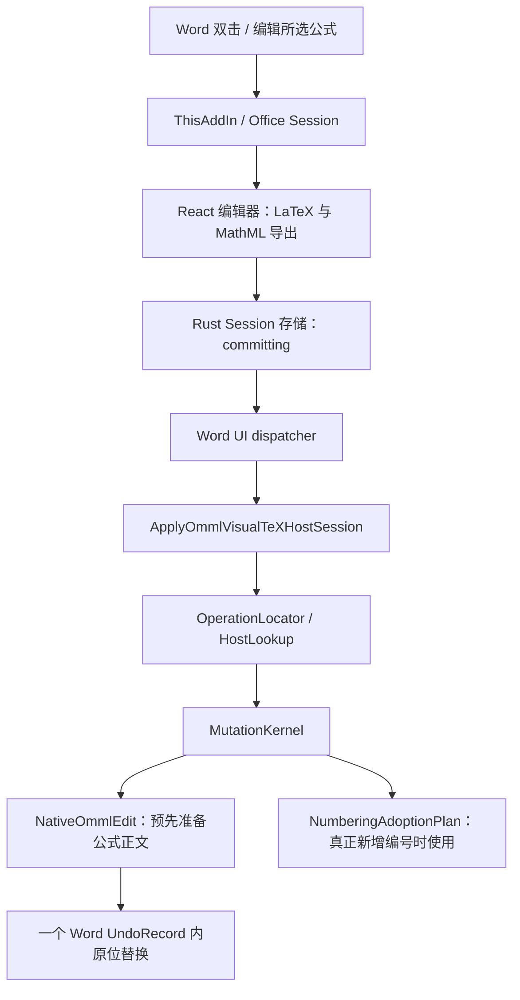

# OMML 编号公式编辑失败：架构审查与根因修正

日期：2026-10-01。对应 checkpoint：CP135–CP140。

## 审查结论

这次报错不是编辑器无法导出用户新输入的公式。失败会话已经带有有效的新 MathML，异常发生在 Word 插件重新识别原公式编号之后、真正替换公式之前。

现有分层方向可继续使用，但原生编号模块违背了分层边界：它用一次局部 XML 导出的成功与否决定公式是否有编号，并把所有读取异常解释成“没有编号”。这会改变后续操作的类型。另一个独立缺陷是首次插入、后续插入与显式编号格式更新对“尚无章节标题”的解释不一致。

本次改动集中修正这两个公共规则，没有增加重试、备用写入路线、持久化公式标识或吞错分支。

## 实际执行链

| 层 | 当前职责与审查结果 |
| --- | --- |
| `OfficeDialogApp.tsx` | 保存编辑状态、生成 MathML、提交 session。OMML 输出以 MathML 为内容，不由 SVG 决定数学语义。失败会话表明内容已到达插件。 |
| `src-tauri/src/office/sessions.rs` | 管理 created/editing/committing/completed/cancelled 状态，防止晚到的自动保存覆盖提交状态。本次异常不发生于此。 |
| `ThisAddIn.cs` | Ribbon、双击和会话生命周期；经 Word dispatcher 调用服务。两个入口最终共用写回链路。 |
| `WordFormulaService.HostCore.cs` | 将 session 转成主机写入请求，按捕获的文档与对象范围定位目标。 |
| `WordFormulaHostLookup` / `WordFormulaOperationLocator` | 局部定位物理主机；原生 OMML 不依赖持久化 FormulaId。编号状态必须来自当前实际主机。 |
| `WordNativeOmmlNumbering` | 应只识别实际 OMath 结构及编号域。原实现额外导出 XML，并在异常后返回 false，是本次修正重点。 |
| `WordFormulaHostMutationKernel` | 根据来源与目标的结构决定普通编辑、编号附加或格式转换。上游错误的 Numbered=false 会把普通编辑错误地转成附加编号。 |
| `WordNativeOmmlEdit` / `WordOmmlHostWriter` | 在事务前准备公式内容，事务内替换准确的 OMath，并保留原编号、书签和局部历史。 |
| `WordNativeNumberingAdoptionPlan` | 为确实新增编号的操作统一处理计数器、前缀和既有原生编号。此前忽略无标题 scope 的有效 NumberText。 |
| `WordFormulaMutationTransaction` | 一个结构变更对应一个 Word 原生撤销记录；失败回滚与已有严格证据核验。XML 导出不能混入事务。 |

三种主机仍需区分：原生 OMML、VisualTeX 自有 OLE、MathType OLE。MathType 的 MTEF/CFB、原生服务器和编号域有各自所有权；不能把修复 OMML 的办法扩散成另一套 MathType 写入机制。本次未修改这些路径。

## 根因证据

### 1. 实际用户进程中的编辑错误

已加载模块 MVID 与 CP134 发布 DLL 一致，排除了仅凭磁盘文件推断版本的误差。原公式为一个 display OMath，范围 409..491，已有 SEQ 域，编号 0-1；文档使用 heading1-dash，无章节标题。

实际用户 Word 进程的只读 CLR 诊断恢复出以下异常栈：

`BuildWordNativeNumberedOmml → PrepareInsertionOmml → MutationKernel.Replace → ApplyOmmlVisualTeXHostSession → ThisAddIn.RunSessionAsync`

这证明普通编辑进入了新增编号准备。会话初始和提交元数据均为 `Numbered=true`，因此不能把问题归因于用户取消编号或输入了某种不支持的公式。

同一进程还保留着被吞掉的异常：

`ExtractSingleOMath → HasVisualTeXDirectSequenceEquationNumber → TryResolveUnownedNativeStructure`

异常内容是 XML 中没有 `m:oMath`。旧识别方法的 `catch { return false; }` 把读取失败转换成了业务上的“未编号”。进程中还保留了只包含空段落的 Flat OPC 字符串；无法追溯它与当时参数的对象引用，不能将其描述为完整调用录制。

用户文档没有被保存、修改或关闭。重新打开 XML 副本，以及新的空白测试文档，未能稳定重现这个瞬时导出状态；这项局限与已取到的实际异常证据分别记录。

### 2. 不应让编号识别承担 XML 序列化

新增真实 Word 回归直接证明：原发布 DLL 的一次编号识别会结束当前自定义 UndoRecord；修正后的同一调用不会。这与此前 CP47 的 WordOpenXML 副作用一致。只读的结构判断依赖序列化，会同时引入错误分类和事务副作用。

### 3. 无标题前缀的确定性缺陷

公共章节解析器已经为标题之前的区域返回 `0` / `0.0`。旧首次插入忽略该值并退成连续编号；旧后续插入却保留章节级别、把前缀清空，最后触发截图中的 ArgumentException。

在空白文档选择 heading1-dash，连续插入两次编号 OMML：旧 DLL 稳定失败，新 DLL 成功。这个用例证明公共编号规则的缺陷，但不冒充用户原始“已有公式编辑失败”的逐步复现。

## 已实施的根本修改

1. `TryResolveUnownedNativeStructure` 通过原生 COM 结构识别编号：准确的外层 eqArr、单行、末尾圆括号及紧邻的 `#`，再确认当前 SEQ/STYLEREF 域属于编号内容范围。移除 XML 导出及 catch-all-to-false。
2. 将原有 `ResolveNumberContentRange` 的结构读取收敛为共同实现；字段编号和纯文字编号共用它。结构条件定义什么才是 Word 原生编号，避免把普通括号、矩阵或正文中的 SEQ 域当编号。
3. `HasFieldFreeWordNativeNumberHost` 使用同一结构读取，移除另一次 XML 导出和吞错。
4. `PrepareNumberedOmml` 与 `PlanInsertion` 共用章节前缀解析规则。只有真实的自动编号标题使用 STYLEREF；手工标题及标题之前的区域采用公共解析器返回的文字前缀。保留构造器对非法前缀的原有约束。

普通编辑继续保留原有编号，不重新生成编号，也不通过忽略构造器错误“强行写入”。

## 审查中确认的后续架构问题

- **构建源存在分叉。** 发布构建通过 artifact 中的 `FreezeR3.targets` 替换 resolver；工作区中另一个 R4 文件被保留。直接默认构建与已接受发布构建并不等价。本次沿用已验证的 R3 输入，未擅自启用尚未验收的 R4。后续应把发布源选择变成仓库内明确、可重复的构建入口。
- **内容读取仍有多处实现。** 语义读取中已有 exact range → 扩展范围的旧重试，编辑预处理另行导出 exact range。它们与编号结构读取应分开；本次取消了编号对这些导出的依赖，没有继续扩充重试。若进一步统一内容快照，需要覆盖修订、REF 缓存和同段多公式的准确物理对应，不能只把取第一个 XML 节点包装成新公共函数。
- **服务与事件入口过大。** `WordFormulaService.cs` 约 573 KB，`ThisAddIn.cs` 约 255 KB，兼容入口与新核心并存。应按主机、会话和转换职责逐步归并，以当前真实调用链为准。文件大本身并不能证明所有历史修正都应删除。
- **验收曾绕过真实加载方式。** 常用 acceptance 环境会抑制已安装插件，并在测试进程中手动托管 ThisAddIn。新增测试明确区分直接服务调用和 Word 进程内真实插件回调，并核对实际加载路径与 MVID。后者仍不是物理鼠标点击的证明。
- **发布时会重新解析 OCR 依赖。** 标准构建在此次封包中将 `filelock` 从 4.0.7 解析到了 4.0.8；其余 wheel 的文件名和摘要一致。这说明已有 lock 文件并没有成为这一步的固定输入。此次保留首轮产物作为证据，恢复 CP134 已验收的完整 OCR 资源后重新构建应用和封包；未修改 OCR 产品代码。后续应明确区分更新依赖和从固定资源发布两个动作。

以上后续问题是已识别的维护风险，不作为这次报错之外的大范围重写理由。

## 验证与交付边界

诊断、原发布 DLL 负例、候选构建和真实 Word 测试结果保存在 `artifacts/omml-edit-audit-20261001/`。新增入口：`word-native-create-edit`、`word-native-number-structure`。完整结果以 checkpoint 最后一次更新为准。

已确认用户原进程的实际报错、旧编号读取破坏撤销事务、旧无标题第二次插入失败。修复候选的真实进程回调编辑原公式副本、8 个结构正反例、20 个普通编辑/历史场景、5 个无标题连续插入场景、16 个纯文字编号生命周期场景、纯文字编号编辑及附加编号回归全部通过。

完整混合编号矩阵也已通过：40 个格式场景（正文/表格 × 自动/手工标题 × 修订关/开 × 五种格式），以及每个环境的故障回滚和保存重开，共各 8 组。检查包括 OMML 与 MathType 独立计数、引用、公式正文和严格撤销重做。验收进程正常退出，结果汇总位于 `artifacts/omml-edit-audit-20261001/cp140-final-acceptance-summary.json`。

原失败现场的瞬时 XML 缺失未能稳定复现，不能把后续副本验收描述成原故障的完整逐步重演。双击和“编辑所选”共用写回链路，真实插件回调已验证；由于本机截图工具故障，未完成物理鼠标双击自动验收。

截至 CP140（21:48），本次没有安装插件、覆盖 Program Files、提交或推送；当时运行中的用户 Word 仍加载原发布 DLL。用户随后自行安装了 CP140，CP141 的实际模块核对已确认新 Word 进程加载修复 DLL。修改源代码不会热替换运行中的组件。

x64、x86 产品均已编译。真实 Word 行为验收运行在本机 x64 Office；x86 的证据限于编译及安装包内容核对，不声称完成了 x86 Office 运行验收。

CP140 安装包 SHA256 为 `E0313979B9E457BEBCD0D5CDD79A398973C6C412BCBAB4D76D2561DB0FC60EB3`。其实际内嵌 x64/x86 Word DLL 与验收候选逐字节一致，OCR 保留 CP134 资源。该安装包已另存为 `artifacts/source-redraw-audit-20261001/previous-cp140-setup.exe`。

## 后续 OLE 源码重绘性能审查（CP141–143）

用户反馈的另一问题是重绘为 VisualTeX OLE 时长时间没有明显反应，最终能够完成。旧 CP134 和 CP140 DLL 的同一组20公式测试都表现为渲染阶段每公式约1秒，因而不能把这个问题归因于刚修改的 OMML 编号逻辑。

当前发布入口仍是隐藏 WebView 中的旧 MathJax → SVG → PNG 流程，新 core 转换辅助模块没有接管这条链路。真实发布页面的分阶段计时确认：SVG 加载通常2～3毫秒，`canvas.toBlob()` 却在隐藏页面中每次等待约1秒。简单空白测试页及刚创建窗口时不能稳定触发，必须保留发布页面和隐藏后的调度状态。主线程 `OffscreenCanvas.convertToBlob()` 同样有延迟，不能作为有效修复。

修复保留原有 DOM Canvas 绘制，直接生成会话需要的 PNG base64，再用同一份编码字节提供 Blob，删除多余的异步编码与 FileReader 回读。只有导出函数及其废弃助手发生产品改动，没有叠加重试或兜底。12种公式的 PNG 与原 DOM Canvas 输出逐字节一致，隐藏转换页面整批约0.2秒。独立 Word 验收20公式约7.2秒（原约25秒）；200公式约58秒，其中约38秒为 Word 创建及写入 OLE。后者通过独立隐藏 WebView 和本机代理执行，不能冒充已安装 Tauri 窗口的同条件计时。

CP143 安装包 SHA256 为 `2A6E41095F0EEAE259ABA14149F2CB191E67572D80E8F9C006D136ABDDFE5BB8`，已另存为 `artifacts/source-redraw-audit-20261001/previous-cp143-setup.exe`。后续其他格式审查与最新交付见下。

## 其他格式的实际路径（CP144–145）

| 操作 | 实际需要的数据 | 本次影响 |
| --- | --- | --- |
| LaTeX → VisualTeX OLE | MathML、SVG、PNG | 直接 PNG 编码消除隐藏页面逐公式空等 |
| LaTeX → MathType | MathML、矢量预览及原生预览 | 隐藏页面原先多生成 PNG，现已删除该步骤 |
| LaTeX → OMML | MathML | 不使用 PNG，不受这次编码等待影响 |
| OMML ↔ MathType | 直接读取源 MathML | 正常路径跳过浏览器重绘；MathType 目标仍有原生预览步骤 |
| VisualTeX → OMML / MathType | 从持久化 LaTeX 生成目标数据 | 分别只生成 MathML、MathML+SVG |
| OMML / MathType → VisualTeX | SVG、PNG、MathML | 共用修复后的 PNG 编码 |
| 三种对象 → LaTeX | 读取已有数学内容或元数据 | 不调用图片编码 |

三种格式各20个公式的真实 Word 重绘全部通过：OMML约8.2秒、MathType约9.8秒、VisualTeX约7.0秒。六方向互转各4个编号公式通过内容、编号、正文、源对象移除、保存重开及恢复 LaTeX 检查；隐藏发布页面36种格式/公式组合通过输出协议检查。完整结果见 `artifacts/source-redraw-audit-20261001/cp145-other-formats-summary.json`。

一次53秒的 MathType→VisualTeX 测试耗时来自诊断代理漏掉正式应用已有的队列唤醒事件。补齐测试宿主的事件后入队到取队为1毫秒，四公式转换约4.4秒。该异常样本保留为测试限制，不计入产品正常耗时；没有因此修改产品轮询或增加补丁。

CP145 安装包的 SHA256 为 `2698712C18AC7BB173B392ACAD3E0B5D37AB038A76D0DC629D1DF36DB9069780`，现留存为 `artifacts/source-redraw-audit-20261001/previous-cp145-setup.exe`。该版已反向核对23个 Office 前端文件与受测版本一致，Office DLL、原生渲染器及 OCR 保持 CP140 内容。后续大批量验收发现的新问题与修复见下。

## 三种格式的大批量重绘与混排编号（CP146–149）

每种目标格式分别测试纯正文、跨页表格、正文与两张表格交替排列；每组200个不同公式，100个行内公式和100个编号独立公式，覆盖简单方程、分式、根式、求和、积分、矩阵。表格包含合并的重复表头、每格多公式和跨页内容，原始文档为9～10页。

| 场景 | VisualTeX OLE | OMML | MathType |
| --- | ---: | ---: | ---: |
| 正文 |121.6秒|133.7秒|70.6秒|
| 跨页表格 |197.2秒|141.5秒|90.9秒|
| 正文、表格混排 |157.1秒|141.6秒|83.2秒|

九组最终结果均通过逐式数学内容、前后文、段落和表格结构、单元格归属、公式位置、实际编号1～100，以及保存重开验证。VisualTeX 三组使用修复后的复测数据；OMML/MathType 六组沿用未进入本次修改分支的初测结果。完整 JSON/CSV 与失败基线保存在 `artifacts/source-redraw-audit-20261001/cp149-large-redraw-results.json`、`cp149-large-redraw-timings.csv`。初测加复测实际执行2400次大批量公式写入，另有小型回归。

测试抓出了一个初始数量检查没有覆盖的错误：VisualTeX 混排在第一张表格后的正文中重复显示26～50，而非51～75。原始失败文档及25个错误序号完整保留，没有把初始 C# 的成功退出当成验收通过。

根因是编号内核把两种顺序混在一起：为了保持捕获的坐标有效，编号结构必须倒序改写；但正文的 SEQ 字段依赖前方表格的显式序号，必须在结构确定后正序求值。原实现倒序遍历时立即刷新正文，于是正文使用了表格尚未改写的旧序号。修复将结构改写和字段求值分开，取消普通正文在倒序阶段的重复刷新，完成所有结构后统一正序计算字段及引用。沿用原有字段结构和更新器，没有新增重试、兜底或产品校验。产品改动限于 `WordFormulaNumberingKernel.cs` 和 `WordVisualTeXParagraphNumbering.cs`。

附加混排回归覆盖五种编号格式、六个用户引用、每次格式改变的一步撤销重做、显式编号更新、数学内容和表格保持及保存重开，全部通过。修复后的 x64 Word DLL 为 `5702CC88C7CF5C795FE92D110AD336495CEE2E9F88FC77E5F207561CEC5D6575`。

性能尚不能宣称解决。VisualTeX 正文、表格、混排的单次总耗时仅分别从128.1、199.2、161.9秒变成121.6、197.2、157.1秒。实际运行指标显示正文编号收尾仍占约56.8秒，其中字段更新约19.9秒、重复编号识别约17.8秒、重新建立范围索引约8.7秒；这些指标有包含关系，不能相加。表格逐式编号还重复遍历增长中的书签集合。因而此前“剩余时间主要是创建 OLE”的说法不足以解释编号大批量场景。

以上是独立隐藏 Word、外部托管 VSTO 与隐藏 WebView 的真实文档测量，包含跨进程 COM 开销；每组一次，排除夹具准备、验证、保存和重开耗时，不等同于用户安装版的界面响应时间。测试没有改动用户文档或重启用户进程。新安装包交付状态以 checkpoint 的最终记录为准。

## 最终交付（CP150，2026-10-02）

最新安装包为 `apps/windows/src-tauri/target/release/bundle/nsis/VisualTeX_1.2.8_x64-setup.exe`，376583853字节，SHA256 `A002AC902D152A27BAEBAF9353FDFED86E3EF73AABCC2F286BAAE1495FB31F09`。实际解包核对通过：x64 Word DLL 与上述验收候选完全一致，x86 已编译及核对；23个 Office 前端文件与测试版本完全一致。PowerPoint、原生渲染器和 OCR 内容保持 CP145 版本。包含此前 OMML 编辑、隐藏页面 PNG 等待、MathType 无用 PNG 清理，以及本次混排编号顺序修复。尚未安装，没有提交或推送。
